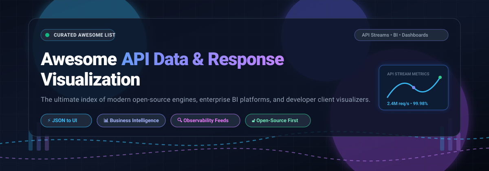

  

# Awesome API Data & Response Visualization 📊🚀

  
  
  
  
  
  
  

> 🌟 A curated directory of tools, platforms, libraries, and frameworks for inspecting, rendering, and transforming API responses and data streams into rich visual charts, interactive dashboards, and business intelligence reports.

---

## 📌 Table of Contents

- [🌐 Sector Overview & Market Dynamics](#-sector-overview--market-dynamics)
- [☁️ SaaS & Commercial Platforms](#-saas--commercial-platforms)
- [🔓 Open-Source Solutions](#-open-source-solutions)
- [🛠️ API Client Response Visualizers](#-api-client-response-visualizers)
- [💖 Support & Community](#-support--community)
- [⭐ Star History](#-star-history)
- [🤝 Contributing](#-contributing)
- [📄 License](#-license)

---

## 🌐 Sector Overview & Market Dynamics

📈 The global Business Intelligence (BI), observability, and data visualization market is estimated at **$34 billion to $40 billion** (2025–2026), expanding at a CAGR of ~10% toward over $70 billion by 2032. 

🏛️ The sector displays a **bifurcated market structure that is highly concentrated (winner-take-most) at the top**—where enterprise hyperscalers like Microsoft (Power BI), Salesforce (Tableau), and Google Cloud (Looker) capture the majority of corporate spending through cloud bundling and enterprise agreements—while remaining **moderately fragmented at the edge**, where agile open-source engines, developer-first frameworks, and specialized AI analytics tools thrive on niche use cases.

---

## ☁️ SaaS & Commercial Platforms

💼 Comparison of leading commercial SaaS platforms for API monitoring, enterprise BI dashboards, and data visualization.

*The table below is sorted descending by company scale (market capitalization / valuation).*

| Product | Scale (Revenue / Valuation) | Pricing (Starting Paid Tier) | Free Tier / Trial Limits | Primary Category |
| :--- | :--- | :--- | :--- | :--- |
| **[Power BI](https://powerbi.microsoft.com/)** | ~$3.1T Market Cap *(Microsoft parent)* | $10.00 / user / month *(Pro tier, billed annually; $14/mo monthly)* | Free Desktop authoring & "My Workspace" cloud sandbox (1 GB model size, 10 GB cloud storage, no direct sharing); 60-day full Pro trial | 📊 Enterprise Business Intelligence |
| **[Looker](https://cloud.google.com/looker)** | ~$2.1T Market Cap *(Alphabet / Google Cloud)* | $5,000.00 / platform / month *(Standard Edition; includes 10 Standard + 2 Developer users, annual contract)* | 90-day free trial on Google Cloud Core; Looker Studio Pro provides 30-day free trial | 🧠 Modern BI & Semantic Modeling |
| **[Tableau](https://www.tableau.com/)** | ~$300B Market Cap *(Salesforce parent; $15.7B acquisition)* | $15.00 / user / month *(Tableau Viewer; Creator starts at $75/user/month billed annually)* | 14-day free trial (full Creator tier access to Cloud, Desktop, and Prep); indefinitely free via Tableau Public (all work is public) | 📉 Data Visualization & Analytics |
| **[Datadog](https://www.datadoghq.com/)** | ~$40B Market Cap *(Public: NASDAQ: DDOG; ~$2.6B ARR)* | $15.00 / host / month *(Pro plan, billed annually; $18/host/month on-demand)* | Free forever plan for up to 5 hosts with 1-day metric retention; 14-day unlimited free trial | 📡 Cloud Monitoring & API Observability |
| **[Postman](https://www.postman.com/)** | ~$5.6B Valuation *(Series D valuation; $100M+ ARR)* | $9.00 / user / month *(Basic/Solo plan, billed annually; Team plan is $19/user/month)* | Free forever for 1 user: up to 10,000 Postman API cloud requests/month, 300 req/min rate limit, 25 Collection Runner executions/month, and basic AI credits | ⚡ API Client & Response Visualizer |
| **[PostHog](https://posthog.com/)** | ~$1.4B Valuation *(Late-stage private; $50M+ ARR)* | $0.000100 / event *(Usage-based pricing kicks in beyond free allowance; Team add-ons start at $150/month)* | 1,000,000 events/month free forever + 5,000 session recordings/month free forever + 250 survey responses/month | 🎯 Product Analytics & Data Visualization |
| **[Klipfolio](https://www.klipfolio.com/)** | ~$30M–$50M Valuation *(Private boot-strapped/venture; ~$15M ARR)* | $120.00 / month *(Base plan, billed annually; 3 dashboards, 4-hour refresh)* | 14-day free trial of Klips (unlimited access to 130+ data connectors, custom modeling, and dashboard sharing without credit card) | 📋 Metric Dashboards & KPI Monitoring |

---

## 🔓 Open-Source Solutions

💻 Self-hosted, transparent, and developer-friendly open-source frameworks and engines for visualizing JSON, REST/GraphQL APIs, SQL databases, and event streams.

*The list below is sorted descending by GitHub stargazers count.*

* **[Grafana](https://github.com/grafana/grafana)**  — 📊 The open and composable observability and data visualization platform. Visualizes time-series metrics, logs, and traces from any database or API endpoint (AGPL-3.0).
* **[Apache Superset](https://github.com/apache/superset)**  — 📈 A modern enterprise data exploration and visualization platform supporting complex SQL queries, rich interactive charts, and extensible dashboard creation (Apache-2.0).
* **[Metabase](https://github.com/metabase/metabase)**  — 🔍 The simplest, fastest way to share data and business analytics. Supports SQL queries, point-and-click questions, and public or locked guest embeds (AGPL-3.0).
* **[Streamlit](https://github.com/streamlit/streamlit)**  — 🚀 A faster way to build and share data apps. Turns data scripts into shareable web applications in minutes with native Python and REST API consumption (Apache-2.0).
* **[ToolJet](https://github.com/ToolJet/ToolJet)**  — 🛠️ Low-code platform for building enterprise internal tools and customizable dashboards connected to REST APIs, GraphQL, and databases (AGPL-3.0).
* **[Appsmith](https://github.com/appsmithorg/appsmith)**  — 🧩 Powerful open-source low-code internal tool framework for building dashboards, admin panels, and visual CRUD interfaces directly bound to REST APIs and SQL (Apache-2.0).
* **[PostHog OSS](https://github.com/PostHog/posthog)**  — 🦔 Open-source product analytics, event visualization, web analytics, session replay, and feature flag management (MIT / Functional Source License).
* **[Redash](https://github.com/getredash/redash)**  — 📬 Connect and query your data sources, build dashboards to visualize data, and share them effortlessly across your team (BSD-2-Clause).
* **[Plotly Dash](https://github.com/plotly/dash)**  — 📉 Enterprise-grade Python framework for building analytical data visualization web applications without JavaScript (MIT).
* **[Cube](https://github.com/cube-js/cube)**  — 🧊 The Semantic Layer for building data applications, embedded business intelligence, and API visualization pipelines (Apache-2.0).
* **[ILLA Cloud](https://github.com/illacloud/illa-builder)**  — 🏗️ Open-source low-code builder designed for developers to build internal tools, UI dashboards, and API workflows rapidly (Apache-2.0).
* **[Evidence](https://github.com/evidence-dev/evidence)**  — 📝 Code-driven Business Intelligence: build fast, interactive data reports and visual dashboards using Markdown, SQL, and component loops (MIT).
* **[Lightdash](https://github.com/lightdash/lightdash)**  — 💡 The open-source Looker alternative built on dbt. Enables full team exploration and metrics dashboard visualization directly from data models (MIT).

---

## 🛠️ API Client Response Visualizers

🔧 Specialized developer tooling inside API testing clients for rendering raw JSON / XML / HTML payloads into UI components:

* **[Postman Visualizer](https://learning.postman.com/docs/sending-requests/visualizer/)** — 🎨 Programmatically convert raw response data into interactive charts, tables, maps, and HTML using `pm.visualizer.set()` with Handlebars, D3.js, Chart.js, or Canvas.
* **[Hoppscotch](https://hoppscotch.com/)** — 🛸 Open-source, lightweight web-based API development ecosystem for sending HTTP, WebSocket, and GraphQL requests with formatted syntax tree viewers.
* **[Insomnia](https://insomnia.rest/)** — 🌙 Streamlined API design and testing desktop client featuring formatted JSON/XML payload previews, schema validators, and timeline views.

---

## 💖 Support & Community

Thank you for exploring and using this collection! ✨ If you found this list helpful:

- ⭐ **Star this repository** to help others discover it and support ongoing maintenance.
- 🍴 **Fork it** and contribute your favorite visualization libraries or tools.
- 📢 **Share it** with fellow engineers, data analysts, and API developers.
- ☕ **Buy me a coffee / Sponsor:** If you enjoy my open-source work and would like to support future updates, consider sponsoring via the **[GitHub Sponsors Dashboard](https://github.com/sponsors/ishandutta2007)**!

---

##  Star History

---

## 🤝 Contributing

Contributions are warmly welcome! 🌟 Please follow these simple steps:

1. 🍴 Fork this repository.
2. 🌿 Create a new branch: `git checkout -b feature/new-tool`.
3. ✏️ Add the tool to the appropriate section maintaining sorting criteria (e.g. GitHub Stars_Count for open-source, scale/revenue for SaaS).
4. 💾 Commit your changes: `git commit -m "Add tool-name"`.
5. 🚀 Push to the branch: `git push origin feature/new-tool`.
6. 📬 Submit a pull request.

---

## 📄 License

This repository is licensed under the [MIT License](LICENSE).
